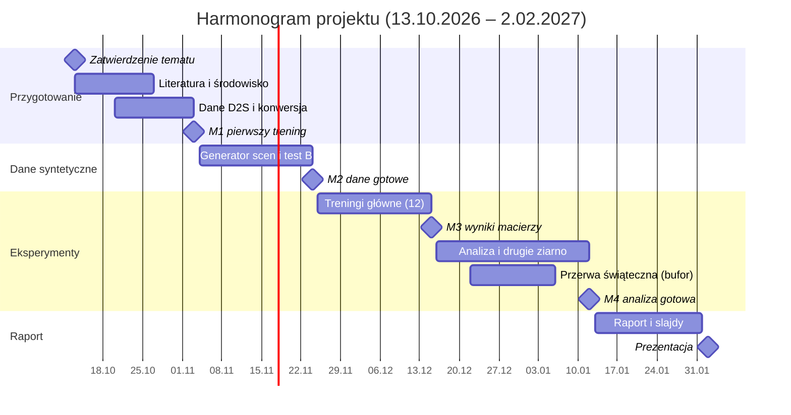

# Detekcja produktów przy okluzji: projekt i harmonogram

Wojciech Kosmalski, 266569

## Temat i cel

**Temat:** Odporność detektorów obiektów na okluzję w zatłoczonych scenach kasowych: porównanie detektora CNN z NMS, detektora CNN bez NMS i detektora transformerowego.

Celem projektu jest zmierzenie, jak szybko spada skuteczność wykrywania produktów wraz ze stopniem ich zasłonięcia, i ustalenie, które rozwiązanie architektoniczne najlepiej radzi sobie z gęsto ułożonymi, nachodzącymi na siebie obiektami. W kasach samoobsługowych (SCO) okluzja jest typowa: produkty leżą na sobie, są częściowo zasłonięte dłonią lub torbą, a przeoczony produkt oznacza produkt nieskasowany.

Klasyczne detektory usuwają zdublowane ramki przez NMS (non-maximum suppression), które może wyciąć prawdziwy obiekt silnie nachodzący na sąsiedni. Nowsze detektory działają bez NMS. Zestawienie trzech modeli pozwala oddzielić wpływ NMS od wpływu architektury sieci.

Projekt realizuję samodzielnie; zakres i harmonogram są dopasowane do jednej osoby.

## Pytania badawcze i plan eksperymentu

- **RQ1:** Jak szybko spada skuteczność detekcji wraz ze stopniem okluzji i czy tempo spadku różni się między architekturami?
- **RQ2:** Czy detektory bez NMS lepiej wykrywają silnie nachodzące na siebie produkty?
- **RQ3:** Czy trening z syntetycznymi okluzjami (copy-paste) zmniejsza spadek skuteczności i czy ta korzyść zależy od architektury?
- **RQ4:** Czy przy okluzji błędy detektora wynikają głównie z lokalizacji (produkt nieznaleziony lub ramka niedokładna), czy z przypisania klasy przez głowicę detekcyjną (porównanie trybu 60-klasowego z trybem class-agnostic)?

**Zakres wniosków.** Wszystkie pytania dotyczą detektorów w zamkniętym zbiorze 60 klas D2S. RQ4 opisuje źródło błędów samego detektora; projekt nie formułuje wniosków o identyfikacji produktów przez dopasowanie do bazy referencyjnej ani o odrzucaniu obiektów spoza asortymentu.

**Modele** (warianty o zbliżonym rozmiarze, żeby porównanie było uczciwe):

| Model         | Architektura                  | Usuwanie duplikatów | Rola w porównaniu                      |
| ------------- | ----------------------------- | ------------------- | -------------------------------------- |
| YOLO11-S      | CNN                           | klasyczne NMS       | punkt odniesienia                      |
| YOLO26-S      | CNN                           | end-to-end, bez NMS | izoluje efekt NMS (vs YOLO11)          |
| RF-DETR Small | transformer (backbone DINOv2) | end-to-end, bez NMS | izoluje efekt architektury (vs YOLO26) |

YOLO26 ma dwie głowice: one-to-one (bez NMS) i opcjonalną one-to-many (z NMS). Pozwala to zmierzyć efekt NMS dodatkowo na jednym modelu, bez różnic w rdzeniu modelu.

**Dane:** MVTec D2S (60 klas produktów, sceny przypominające automatyczną kasę). Zbiór treningowy zawiera pojedyncze obiekty na jednolitym tle, walidacyjny – zatłoczone sceny. Adnotacje testowe D2S nie są publiczne, więc walidacja D2S pełni rolę zbioru testowego, a walidację wydzielam z treningu. Zapasowo: RPC (poziomy trudności według zagęszczenia produktów).

**Zaszumienie danych w dwóch miejscach:**

- **Test A – okluzja realna:** sceny z walidacji D2S; stopień okluzji przybliżony na podstawie nakładania się obiektów.
- **Test B – okluzja kontrolowana:** sceny syntetyczne złożone z wycinków produktów (maski D2S). Pełna maska każdego obiektu jest znana, więc procent zasłonięcia liczony jest dokładnie i grupowany w przedziały 0–20%, 20–40%, 40–60%, 60–80%. Wycinki pochodzą z obrazów nieużytych w treningu.
- **Reżim treningu R1:** tylko oryginalne izolowane obiekty.
- **Reżim treningu R2:** R1 + syntetyczne zatłoczone sceny copy-paste.

**Macierz eksperymentów:** 3 modele × 2 reżimy × 2 tryby etykiet (60 klas / jedna klasa „produkt”) = 12 treningów. Drugie ziarno losowe dla 6 konfiguracji 60-klasowych daje łącznie 18 treningów.

**Metryki:** mAP@50:95 i mAP@50 (protokół COCO), recall przy IoU 0,5 w każdym przedziale okluzji (główna metryka, bo przeoczenie = produkt nieskasowany), udział pomyłek klasy, latencja na CPU (ms/obraz).

**Środowisko:** PyTorch, pakiety `ultralytics` i `rfdetr`, darmowe GPU na Kaggle, rozdzielczość wejścia ok. 640 px. Oba pakiety przyjmują adnotacje w formacie YOLO, więc wystarczy jedna konwersja danych D2S.

## Związek z pracą magisterską

Temat pracy magisterskiej nie jest jeszcze ustalony: zależy przede wszystkim od tego, czy uzyskam dostęp do danych ze środowiska SCO. Rozważane są dwa kierunki, oba z obszaru computer vision dla kas samoobsługowych. Projekt jest pomyślany tak, by był samodzielny i przydatny niezależnie od ostatecznego wyboru.

| Rozważany kierunek pracy                            | Opis                                                                                                                      | Co wnosi projekt                                                                                                        |
| --------------------------------------------------- | ------------------------------------------------------------------------------------------------------------------------- | ----------------------------------------------------------------------------------------------------------------------- |
| Rozpoznawanie produktów przez embeddingi (open-set) | detektor lokalizuje produkty, model embeddingowy dopasowuje je do bazy referencyjnej i odróżnia obiekty spoza asortymentu | wybór detektora pełniącego rolę lokalizatora, jego skuteczność w trybie class-agnostic, generator scen i pomiar okluzji |
| Analiza czasowa (krótkie sekwencje wideo)           | analiza kilku sekund nagrania zamiast pojedynczej klatki, by lepiej wykrywać nieskasowane produkty                        | pomiar, ile traci detekcja na pojedynczej klatce przy okluzji – punkt odniesienia dla agregacji wielu klatek            |

**Podział wkładu.** Projekt jest samodzielnym badaniem wstępnym względem pracy magisterskiej. Do pracy mogą przejść wyłącznie narzędzia i decyzje projektowe: generator scen copy-paste, sposób pomiaru stopnia okluzji oraz wybór detektora. Praca będzie cytować projekt jako wcześniejszy, osobno zaliczony wkład autora. Wyniki projektu (porównanie architektur, krzywe spadku skuteczności detekcji, odpowiedzi na RQ1–RQ4) nie będą przedstawiane jako wkład pracy.

Wkład pracy zaczyna się tam, gdzie kończy się projekt. W kierunku open-set jest to dopasowanie produktów do bazy referencyjnej, odrzucanie obiektów spoza asortymentu i progi decyzyjne; w kierunku czasowym – agregacja informacji z wielu klatek. Projekt ogranicza się do publicznych danych i nie obejmuje embeddingów ani analizy wideo; te elementy należą wyłącznie do pracy magisterskiej. Podział doprecyzuję po ustaleniu jej tematu.

Licencje wymuszają czysty podział: MVTec D2S nie może być używany komercyjnie, a pakiet Ultralytics jest na licencji AGPL-3.0. Projekt pozostaje więc czysto akademicki.

## Harmonogram

Projekt trwa 16 tygodni, od zatwierdzenia tematu 13.10.2026 do prezentacji 2.02.2027; treningi główne kończą się 15.12.2026.

Łączny nakład to ok. 80–90 h: literatura i środowisko ok. 12 h, generator scen ok. 20 h, treningi ok. 15 h (głównie oczekiwanie na GPU), analiza ok. 15 h, raport i prezentacja ok. 15 h. Przerwa świąteczna jest buforem: opóźnienie treningów przesuwa analizę na styczeń bez ryzyka dla terminu prezentacji.

Kamień M1 to także punkt decyzyjny: jeśli pomiar czasu epoki RF-DETR pokaże, że 18 treningów nie zmieści się w limicie GPU, rezygnuję z drugiego ziarna.

## Załącznik: materiały do przeglądu literatury

Priorytet „wysoki” oznacza pozycje, które warto przeczytać w całości przed startem eksperymentów; resztę wystarczy przejrzeć (abstrakt, wnioski, kluczowe rysunki).

### Badane modele

| Źródło                                                                                                                   | Typ      | Po co                                           | Priorytet |
| ------------------------------------------------------------------------------------------------------------------------ | -------- | ----------------------------------------------- | --------- |
| [RF-DETR: Neural Architecture Search for Real-Time Detection Transformers](https://arxiv.org/abs/2511.09554) (ICLR 2026) | artykuł  | architektura RF-DETR, porównania z YOLO         | wysoki    |
| [Ultralytics YOLO26: Unified Real-Time End-to-End Vision Models](https://arxiv.org/abs/2606.03748)                       | artykuł  | dwie głowice, inferencja bez NMS                | wysoki    |
| [Ultralytics YOLO Evolution: YOLO26, YOLO11, YOLOv8, YOLOv5](https://arxiv.org/abs/2510.09653)                           | przegląd | różnice między YOLO11 a YOLO26 w jednym miejscu | wysoki    |
| [LW-DETR](https://arxiv.org/abs/2406.03459)                                                                              | artykuł  | architektura, na której bazuje RF-DETR          | średni    |
| [DINOv2](https://arxiv.org/abs/2304.07193)                                                                               | artykuł  | backbone RF-DETR                                | średni    |
| [YOLOv10: Real-Time End-to-End Object Detection](https://arxiv.org/abs/2405.14458)                                       | artykuł  | geneza podejścia NMS-free w rodzinie YOLO       | średni    |

### Podstawy architektur detekcji

| Źródło                                                                                                  | Typ               | Po co                                                              | Priorytet |
| ------------------------------------------------------------------------------------------------------- | ----------------- | ------------------------------------------------------------------ | --------- |
| [DETR: End-to-End Object Detection with Transformers](https://arxiv.org/abs/2005.12872)                 | artykuł           | detekcja jako predykcja zbioru, dopasowanie węgierskie zamiast NMS | wysoki    |
| [You Only Look Once (YOLO v1)](https://arxiv.org/abs/1506.02640)                                        | artykuł           | idea detektora jednoetapowego                                      | średni    |
| [Deformable DETR](https://arxiv.org/abs/2010.04159)                                                     | artykuł           | jak przyspieszono uczenie DETR                                     | średni    |
| [RT-DETR: DETRs Beat YOLOs on Real-time Object Detection](https://arxiv.org/abs/2304.08069)             | artykuł           | pierwszy transformerowy detektor czasu rzeczywistego               | średni    |
| [Vision Transformer (ViT)](https://arxiv.org/abs/2010.11929)                                            | artykuł           | podstawy transformerów w wizji                                     | średni    |
| [ResNet](https://arxiv.org/abs/1512.03385)                                                              | artykuł           | klasyczny backbone CNN                                             | niski     |
| [Dive into Deep Learning – rozdział Computer Vision](https://d2l.ai/chapter_computer-vision/index.html) | podręcznik online | anchor boxy, IoU, NMS, mAP z kodem                                 | wysoki    |
| [Stanford CS231n](https://cs231n.stanford.edu/)                                                         | kurs              | uporządkowanie podstaw CNN i detekcji                              | średni    |

### Okluzja, gęste sceny i NMS

| Źródło                                                                                                 | Typ             | Po co                                               | Priorytet |
| ------------------------------------------------------------------------------------------------------ | --------------- | --------------------------------------------------- | --------- |
| [Occlusion Handling in Generic Object Detection: A Review](https://arxiv.org/abs/2101.08845)           | przegląd        | taksonomia problemów i metod okluzji                | wysoki    |
| [Survey of Occlusion-Handling Approaches (Electronics, 2024)](https://www.mdpi.com/2079-9292/13/3/541) | przegląd        | nowszy przegląd z ewaluacją detektorów przy okluzji | średni    |
| [Adaptive NMS: Refining Pedestrian Detection in a Crowd](https://arxiv.org/abs/1904.03629)             | artykuł         | dlaczego stały próg NMS zawodzi w tłumie            | wysoki    |
| [Soft-NMS](https://arxiv.org/abs/1704.04503)                                                           | artykuł         | klasyczna alternatywa dla twardego NMS              | średni    |
| [CrowdHuman](https://arxiv.org/abs/1805.00123)                                                         | artykuł / zbiór | jak mierzyć detekcję w gęstych scenach              | niski     |
| [Intriguing Properties of Vision Transformers](https://arxiv.org/abs/2105.10497) (NeurIPS 2021)        | artykuł         | odporność ViT vs CNN na okluzję – źródło hipotezy   | wysoki    |
| [Robustness of object recognition under extreme occlusion](https://arxiv.org/abs/1905.04598)           | artykuł         | ludzie vs modele przy silnej okluzji                | niski     |

### Augmentacja i dane syntetyczne

| Źródło                                                                                                 | Typ     | Po co                                | Priorytet |
| ------------------------------------------------------------------------------------------------------ | ------- | ------------------------------------ | --------- |
| [Simple Copy-Paste is a Strong Data Augmentation Method](https://arxiv.org/abs/2012.07177) (CVPR 2021) | artykuł | podstawa reżimu R2                   | wysoki    |
| [Cut, Paste and Learn](https://arxiv.org/abs/1708.01642)                                               | artykuł | synteza scen z wycinków obiektów     | średni    |
| [Cutout](https://arxiv.org/abs/1708.04552)                                                             | artykuł | okluzja prostokątna jako augmentacja | niski     |
| [Random Erasing](https://arxiv.org/abs/1708.04896)                                                     | artykuł | jw., wariant losowy                  | niski     |

### Dane (retail / automatyczna kasa)

| Źródło                                                                                       | Typ          | Po co                              | Priorytet |
| -------------------------------------------------------------------------------------------- | ------------ | ---------------------------------- | --------- |
| [MVTec D2S – artykuł](https://arxiv.org/abs/1804.08292) (ECCV 2018)                          | artykuł      | opis zbioru, wyniki bazowe         | wysoki    |
| [MVTec D2S – strona i pobieranie](https://www.mvtec.com/company/research/datasets/mvtec-d2s) | zbiór danych | licencja, pliki, format adnotacji  | wysoki    |
| [RPC: A Large-Scale Retail Product Checkout Dataset](https://arxiv.org/abs/1901.07249)       | artykuł      | zbiór zapasowy, poziomy trudności  | średni    |
| [RPC – strona zbioru](https://rpc-dataset.github.io/)                                        | zbiór danych | pobieranie                         | niski     |
| [SKU-110K: Precise Detection in Densely Packed Scenes](https://arxiv.org/abs/1904.00853)     | artykuł      | detekcja gęsto ułożonych produktów | średni    |
| [COCO](https://arxiv.org/abs/1405.0312)                                                      | artykuł      | protokół metryk mAP                | niski     |

### Narzędzia, dokumentacje i tutoriale

| Źródło                                                                                                   | Typ          | Po co                                      |
| -------------------------------------------------------------------------------------------------------- | ------------ | ------------------------------------------ |
| [Ultralytics – YOLO26](https://docs.ultralytics.com/models/yolo26/)                                      | dokumentacja | modele, tryb end-to-end                    |
| [Ultralytics – YOLO11](https://docs.ultralytics.com/models/yolo11/)                                      | dokumentacja | model bazowy z NMS                         |
| [Ultralytics – trening](https://docs.ultralytics.com/modes/train/)                                       | dokumentacja | parametry treningu, augmentacje            |
| [Ultralytics – format zbioru detekcyjnego](https://docs.ultralytics.com/datasets/detect/)                | dokumentacja | konwersja D2S do formatu YOLO              |
| [Ultralytics – metryki](https://docs.ultralytics.com/guides/yolo-performance-metrics/)                   | poradnik     | interpretacja mAP, precision, recall       |
| [Ultralytics – GitHub](https://github.com/ultralytics/ultralytics)                                       | kod          | źródła, issues                             |
| [RF-DETR – trening](https://rfdetr.roboflow.com/latest/learn/train/)                                     | dokumentacja | trening na własnym zbiorze (COCO lub YOLO) |
| [RF-DETR – GitHub](https://github.com/roboflow/rf-detr)                                                  | kod          | źródła, przykładowe notebooki              |
| [How to Train RF-DETR on a Custom Dataset](https://blog.roboflow.com/train-rf-detr-on-a-custom-dataset/) | tutorial     | trening krok po kroku                      |
| [COCO – opis metryk detekcji](https://cocodataset.org/#detection-eval)                                   | dokumentacja | definicje AP, AR, progi IoU                |

Linki do artykułów RF-DETR, YOLO26, D2S, RPC, Copy-Paste, Adaptive NMS, przeglądu okluzji i ViT zostały zweryfikowane 11.10.2026.
