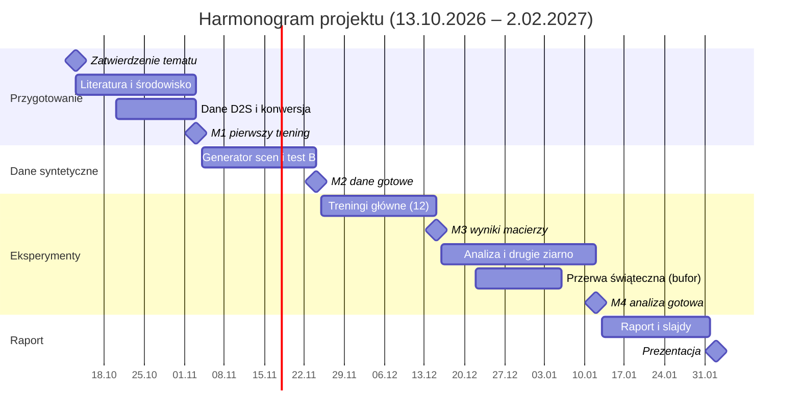

# Detekcja produktów przy okluzji: projekt i harmonogram

Wojciech Kosmalski, 266569

## Temat i cel

**Temat:** Odporność detektorów obiektów na okluzję w zatłoczonych scenach kasowych: porównanie detektora CNN z NMS, detektora CNN bez NMS i detektora transformerowego.

Celem projektu jest zmierzenie, jak szybko spada skuteczność wykrywania produktów wraz ze stopniem ich zasłonięcia, i ustalenie, które rozwiązanie architektoniczne najlepiej radzi sobie z gęsto ułożonymi, nachodzącymi na siebie obiektami. W kasach samoobsługowych (SCO) okluzja jest typowa: produkty leżą na sobie, są częściowo zasłonięte dłonią lub torbą, a przeoczony produkt oznacza produkt nieskasowany.

Klasyczne detektory usuwają zdublowane ramki przez NMS (non-maximum suppression), które może wyciąć prawdziwy obiekt silnie nachodzący na sąsiedni. Nowsze detektory działają bez NMS. Zestawienie trzech modeli pozwala oddzielić wpływ NMS od wpływu architektury sieci.

Projekt realizuję samodzielnie; zakres i harmonogram są dopasowane do jednej osoby.

## Pytania badawcze i plan eksperymentu

- **RQ1:** Jak szybko spada skuteczność detekcji wraz ze stopniem okluzji i czy tempo spadku różni się między architekturami?
- **RQ2:** Czy detektory bez NMS lepiej wykrywają silnie nachodzące na siebie produkty?
- **RQ3:** Czy trening z syntetycznymi okluzjami (copy-paste) zmniejsza spadek skuteczności i czy ta korzyść zależy od architektury?
- **RQ4:** Czy przy okluzji błędy detektora wynikają głównie z lokalizacji (produkt nieznaleziony lub ramka niedokładna), czy z przypisania klasy przez głowicę detekcyjną (porównanie trybu 60-klasowego z trybem class-agnostic)?

**Zakres wniosków.** Wszystkie pytania dotyczą detektorów w zamkniętym zbiorze 60 klas D2S. RQ4 opisuje źródło błędów samego detektora; projekt nie formułuje wniosków o identyfikacji produktów przez dopasowanie do bazy referencyjnej ani o odrzucaniu obiektów spoza asortymentu.

**Modele** (warianty o zbliżonym rozmiarze, żeby porównanie było uczciwe):

| Model         | Architektura                  | Usuwanie duplikatów | Rola w porównaniu                      |
| ------------- | ----------------------------- | ------------------- | -------------------------------------- |
| YOLO11-S      | CNN                           | klasyczne NMS       | punkt odniesienia                      |
| YOLO26-S      | CNN                           | end-to-end, bez NMS | izoluje efekt NMS (vs YOLO11)          |
| RF-DETR Small | transformer (backbone DINOv2) | end-to-end, bez NMS | izoluje efekt architektury (vs YOLO26) |

YOLO26 ma dwie głowice: one-to-one (bez NMS) i opcjonalną one-to-many (z NMS). Pozwala to zmierzyć efekt NMS dodatkowo na jednym modelu, bez różnic w rdzeniu modelu.

**Dane:** MVTec D2S (60 klas produktów, sceny przypominające automatyczną kasę). Zbiór treningowy zawiera pojedyncze obiekty na jednolitym tle, walidacyjny – zatłoczone sceny. Adnotacje testowe D2S nie są publiczne, więc walidacja D2S pełni rolę zbioru testowego, a walidację wydzielam z treningu (2 z 10 obrotów każdej sceny, tylko do monitorowania treningu). Zapasowo: RPC (poziomy trudności według zagęszczenia produktów).

**Zaszumienie danych w dwóch miejscach:**

- **Test A – okluzja realna:** sceny z walidacji D2S; stopień okluzji każdego obiektu liczony dokładnie z adnotacji amodalnych D2S Amodal jako udział niewidocznej części pełnej maski.
- **Test B – okluzja kontrolowana:** sceny syntetyczne złożone z wycinków produktów (maski D2S). Pełna maska każdego obiektu jest znana, więc procent zasłonięcia liczony jest dokładnie i grupowany w przedziały 0–20%, 20–40%, 40–60%, 60–80%. Wycinki pochodzą z obrazów nieużytych w treningu: są to niezasłonięte obiekty z walidacji D2S. Test B jest głównym źródłem wniosków dla okluzji powyżej 40%, bo w teście A takich obiektów jest niewiele.
- **Reżim treningu R1:** tylko oryginalne izolowane obiekty.
- **Reżim treningu R2:** R1 + syntetyczne zatłoczone sceny copy-paste.

**Macierz eksperymentów:** 3 modele × 2 reżimy × 2 tryby etykiet (60 klas / jedna klasa „produkt”) = 12 treningów. Drugie ziarno losowe dla 6 konfiguracji 60-klasowych daje łącznie 18 treningów.

**Metryki:** mAP@50:95 i mAP@50 (protokół COCO), recall przy IoU 0,5 w każdym przedziale okluzji (główna metryka, bo przeoczenie = produkt nieskasowany), udział pomyłek klasy, latencja na CPU (ms/obraz).

**Środowisko:** PyTorch, pakiety `ultralytics` i `rfdetr`, darmowe GPU na Kaggle, rozdzielczość wejścia ok. 640 px. Oba pakiety przyjmują adnotacje w formacie YOLO, więc wystarczy jedna konwersja danych D2S.

## Związek z pracą magisterską

Kierunek pracy magisterskiej jest ustalony i będzie dotyczył rozpoznawania produktów w zbiorze otwartym (open-set) przez embeddingi. Detektor lokalizuje produkty, model embeddingowy dopasowuje każdy wykryty obiekt do bazy referencyjnej asortymentu, a obiekty spoza asortymentu są odrzucane na podstawie progów odległości. Praca zbada, jak okluzja wpływa na identyfikację produktów znanych i na odrzucanie nieznanych, oraz jak ustalać progi odrzucania. Szczegółowy temat i pytania badawcze doprecyzuję jeszcze z promotorem.

Oba badania dotyczą okluzji, ale na różnych etapach przetwarzania: projekt mierzy, czy detektor znajdzie zasłonięty produkt, a praca – czy znaleziony produkt zostanie poprawnie rozpoznany albo odrzucony.

**Podział wkładu.** Projekt jest samodzielnym badaniem wstępnym względem pracy magisterskiej. Do pracy mogą przejść wyłącznie narzędzia i decyzje projektowe: wybór detektora pełniącego rolę lokalizatora (w tym jego skuteczność w trybie class-agnostic), generator scen copy-paste oraz sposób pomiaru stopnia okluzji. Wyniki projektu (porównanie architektur, krzywe spadku skuteczności detekcji, odpowiedzi na RQ1–RQ4) nie będą przedstawiane jako wkład pracy.

Wkład pracy zaczyna się tam, gdzie kończy się projekt: dopasowanie produktów do bazy referencyjnej, odrzucanie obiektów spoza asortymentu, progi decyzyjne i wpływ okluzji na te elementy. Projekt ogranicza się do publicznych danych i detekcji w zamkniętym zbiorze 60 klas; nie obejmuje embeddingów ani progów odrzucania – te elementy należą wyłącznie do pracy magisterskiej.

Licencje wymuszają czysty podział: MVTec D2S nie może być używany komercyjnie, a pakiet Ultralytics jest na licencji AGPL-3.0. Projekt pozostaje więc czysto akademicki.

## Harmonogram

Projekt trwa 16 tygodni, od zatwierdzenia tematu 13.10.2026 do prezentacji 2.02.2027; treningi główne kończą się 15.12.2026.

Łączny nakład to ok. 80–90 h: literatura i środowisko ok. 12 h, generator scen ok. 20 h, treningi ok. 15 h (głównie oczekiwanie na GPU), analiza ok. 15 h, raport i prezentacja ok. 15 h. Przerwa świąteczna jest buforem: opóźnienie treningów przesuwa analizę na styczeń bez ryzyka dla terminu prezentacji.

Kamień M1 to także punkt decyzyjny: jeśli pomiar czasu epoki RF-DETR pokaże, że 18 treningów nie zmieści się w limicie GPU, rezygnuję z drugiego ziarna.

## Załącznik: materiały do przeglądu literatury

- Podstawy detekcji i transformerów
  1. You Only Look Once: Unified, Real-Time Object Detection: https://arxiv.org/abs/1506.02640
  2. Attention Is All You Need: https://arxiv.org/abs/1706.03762
  3. An Image is Worth 16x16 Words: Transformers for Image Recognition at Scale (ViT): https://arxiv.org/abs/2010.11929
  4. End-to-End Object Detection with Transformers (DETR): https://arxiv.org/abs/2005.12872
  5. Deformable DETR: Deformable Transformers for End-to-End Object Detection: https://arxiv.org/abs/2010.04159
- Problem okluzji
  1.  Occlusion Handling in Generic Object Detection: A Review: https://arxiv.org/abs/2101.08845
  2.  Intriguing Properties of Vision Transformers: https://arxiv.org/abs/2105.10497
- Porównywane modele
  1.  Ultralytics YOLO Evolution: YOLO26, YOLO11, YOLOv8, YOLOv5: https://arxiv.org/abs/2510.09653
  2.  Ultralytics YOLO26: Unified Real-Time End-to-End Vision Models: https://arxiv.org/abs/2606.03748
  3.  DINOv2: Learning Robust Visual Features without Supervision: https://arxiv.org/abs/2304.07193
  4.  LW-DETR: A Transformer Replacement to YOLO for Real-Time Detection: https://arxiv.org/abs/2406.03459
  5.  RF-DETR: Neural Architecture Search for Real-Time Detection Transformers: https://arxiv.org/abs/2511.09554
- Augmentacja i generowanie okluzji
  1.  Cut, Paste and Learn: Surprisingly Easy Synthesis for Instance Detection: https://arxiv.org/abs/1708.01642
  2.  Simple Copy-Paste is a Strong Data Augmentation Method for Instance Segmentation: https://arxiv.org/abs/2012.07177
- Zbiór danych
  1.  MVTec D2S: Densely Segmented Supermarket Dataset: https://arxiv.org/abs/1804.08292
  2.  Learning to See the Invisible: End-to-End Trainable Amodal Instance Segmentation (D2S Amodal): https://arxiv.org/abs/1804.08864
